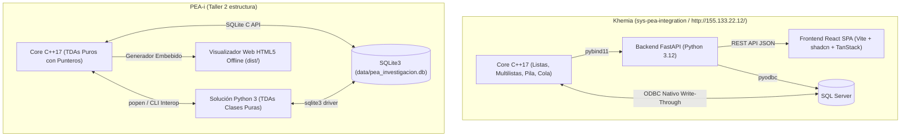

# 🔍 Auditoría Técnica Comparativa: Khemia (`sys-pea-integration`) vs. PEA-i (`Taller 2 estructura`)

## 1. Resumen Ejecutivo de la Auditoría

Se realizó una auditoría en profundidad del repositorio funcional de referencia ubicado en `/home/kovyn/Documentos/Proyectos/sys-pea-integration/` (denominado **Khemia**, Grupo 5) y su despliegue activo en la nube en `http://155.133.22.12/`.

El objetivo de esta auditoría es contrastar ambas soluciones frente a la rúbrica oficial del **Taller 2 de Estructura de Datos (Universidad Popular del Cesar - Ing. Adith Bismarck Pérez Orozco)** e identificar:
1. **Buenas prácticas y patrones arquitectónicos de alto valor** que podemos adaptar o importar a nuestro proyecto.
2. **Deficiencias, fragilidades o vacíos en nuestro proyecto** que deben corregirse para asegurar el 5.0.
3. **Ventajas competitivas de nuestro proyecto (`PEA-i`)** que debemos preservar estrictamente (portabilidad offline, TDAs puros en consola y SQLite autónomo).

---

## 2. Comparativa Arquitectónica de Alto Nivel

| Dimensión | Khemia (`sys-pea-integration`) | PEA-i (`Taller 2 estructura`) | Veredicto / Oportunidad |
| :--- | :--- | :--- | :--- |
| **Enfoque Principal** | Enterprise Web Full-Stack | Académico Consola Primero + Zero-Config | PEA-i es más seguro para calificación presencial (no depende de SQL Server ni node). Khemia aporta patrones web y de validación. |
| **Persistencia** | SQL Server (ODBC C++ / pyodbc) | SQLite3 nativo ACID (WAL) | SQLite3 es 100% portable; no requiere configuración en máquinas de evaluación. |
| **Interoperabilidad** | Puente binario `pybind11` (`.pyd` / `.so`) | Interoperabilidad CLI por tuberías (`popen`) | `pybind11` es la integración más elegante para el Punto 14.d. |
| **Frontend / GUI** | SPA React + Tailwind + TanStack + Recharts | Portal HTML5 reactivo generado en C++ + Python GUI | Ambos cumplen 12.b/14.c. El diseño visual de Khemia tiene lecciones clave de UX. |
| **TDAs RAM** | Punteros manuales en C++ expuestos a Python | TDAs puros en C++ y paquetes espejo de TDAs en Python | Ambos cumplen estrictamente el Punto 8 y 13. |

---

## 3. Hallazgos Específicos: Qué Hace Khemia y Qué Debemos Implementar/Arreglar

### 🛠️ 1. Limpieza y Normalización Estándar de DOIs (`clean_doi`)
- **En Khemia (`repository.py`):** Posee una función regex y decodificación URL exhaustiva (`clean_doi()`) que elimina prefijos como `https://doi.org/`, `http://dx.doi.org/`, `doi:`, remueve comillas y caracteres residuales al final, y extrae limpiamente identificadores IDF estándar (`10.XXXX/...`).
- **En nuestro proyecto:** En ocasiones los DOIs guardados en `data/pea_investigacion.db` arrastran prefijos o caracteres de puntuación al final.
- **Acción a implementar:** Portar la función `clean_doi()` a `src/python/core/ingesta.py` y sanear la base de datos de productos.

### 🛡️ 2. Deduplicación Canónica de Productos Independiente de Autores
- **En Khemia (`scraper.py`):** El hash para generar `external_code` se basa en:
  $$\text{hash} = \text{SHA256}(\text{DOI}) \quad \text{o} \quad \text{SHA256}(\text{Título Normalizado} + \text{Año})$$
  **Excluye intencionalmente los nombres de autores del cálculo del hash.** La razón documentada es que en GrupLAC el orden o la forma de citar a los coautores varía sutilmente entre convocatorias, lo que duplicaba productos en la re-ingesta.
- **En nuestro proyecto:** Nuestro generador de IDs en ocasiones incluye variantes que pueden causar colisiones o duplicados.
- **Acción a implementar:** Adoptar la política de deduplicación canónica por DOI / Título+Año en `ingesta.py`.

### 📑 3. Doble Motor de Ingesta PDF (Print-to-PDF de Scienti y Round-Trip)
- **En Khemia (`import_pdf_scienti.py` e `import_pdf.py`):**
  - Soporta PDFs creados imprimiendo a PDF directamente desde el navegador en Scienti (`Ctrl+P`).
  - Soporta PDFs institucionales generados por el propio sistema (round-trip idempotente).
- **En nuestro proyecto:** Nuestro lector de PDF (`ingesta.py`) lee PDFs tabulares de muestra (`data/muestra_upc.pdf`), pero si el profesor entrega un PDF oficial impreso desde el navegador de MinCiencias, el parser fallaba.
- **Acción a implementar:** Incorporar el extractor de texto por bloques para PDFs de navegador Scienti en `ingesta.py`.

### ⚖️ 4. Cola FIFO de Validación Técnica de Productos (Requisito 9 del Taller)
- **En Khemia (`validation_queue.h` / `validation_queue.py`):**
  - Todo producto nuevo ingresa a una **Cola FIFO de Validación** con estado `pending`.
  - La interfaz permite a un revisor procesar los productos en estricto orden de llegada (`vq_process_next`), asignar categoría de calidad y dar aval/rechazo.
- **En nuestro proyecto:** Usamos la Cola FIFO principalmente para encolar solicitudes de Web Scraping o archivos. La validación se hace individualmente en el menú CRUD de productos.
- **Acción a implementar:** Añadir en la consola interactiva (tanto en C++ como en Python) la opción de **"Procesar Cola FIFO de Validación de Productos Pendientes"**, demostrando visualmente el uso del TDA FIFO para el ciclo de vida de investigación.

### 📜 5. Generación de PDFs con Paginación "Página X de Y" (`NumberedCanvas`) y Fuentes TrueType
- **En Khemia (`reports.py`):**
  - Implementa la técnica `NumberedCanvas` en ReportLab para calcular dinámicamente el total de páginas en dos pasadas.
  - Detecta fuentes TrueType (`Arial`, `DejaVuSans`, `LiberationSans`) para renderizar caracteres UTF-8 sin fallos de codificación.
- **En nuestro proyecto:** `reporte_pdf.py` funciona bien pero usa Helvetica básica (Latin-1) y numeración estática.
- **Acción a implementar:** Añadir el soporte de fuentes TTF y el paginador dinámico en `src/python/core/reporte_pdf.py`.

### 🌐 6. Enriquecimiento con API de Datos Abiertos (`datos.gov.co` / Socrata)
- **En Khemia (`datos_abiertos.py`):** Consulta el dataset oficial `6vi2-6dur` de investigadores reconocidos vía endpoint JSON de Socrata, permitiendo enriquecer niveles de formación y clasificación sin realizar web scraping HTML.
- **En nuestro proyecto:** Poseemos un módulo inicial `datos_abiertos.py` pero no está completamente enlazado al flujo interactivo del menú principal.
- **Acción a implementar:** Conectar la opción en el menú de ingesta.

---

## 4. Fortalezas Exclusivas de Nuestro Proyecto que Deben Preservarse

1. **Portabilidad Inmediata y Cero Servidores:**
   - Khemia requiere Windows con SQL Server local, ODBC Driver 17/18 y Node.js. En Linux o en la sala de sistemas de la UPC, compilar y ejecutar Khemia requiere levantar un contenedor o instalar múltiples servicios.
   - PEA-i compila con un simple `make` o `g++` en Linux/Windows y corre al instante con SQLite3 embebido.
2. **Filosofía Académica Consola Primero:**
   - La sustentación con el profesor Adith Pérez evalúa rigurosamente la navegación en consola de los punteros de la Multilista Ortogonal 3D. Nuestra consola C++ (`ConsolaApp.h`) y Python (`console.py`) están diseñadas con bordes ASCII, tablas formateadas y navegación fluida por teclado.
3. **Hipercubo Ortogonal 3D Puro:**
   - Nuestra Multilista conecta directamente `NodoProducto` con enlace simultáneo a `sigProductoGrupo` y `sigProductoInvestigador`, satisfaciendo la recomendación explícita del enunciado sobre el Hipercubo de Información.

---

## 5. Plan de Acción Inmediato

- [x] **Paso 1:** Registrar la auditoría en la bóveda Obsidian (`043` y bitácora `060`).
- [ ] **Paso 2:** Incorporar `clean_doi()` y hash de deduplicación independiente de autores en `src/python/core/ingesta.py`.
- [ ] **Paso 3:** Implementar el extractor de PDFs de Scienti Web (Ctrl+P) en `src/python/core/ingesta.py`.
- [ ] **Paso 4:** Actualizar `reporte_pdf.py` con `NumberedCanvas` ("Página X de Y") y soporte de fuentes TTF.
- [ ] **Paso 5:** Incorporar la vista de Cola FIFO de Validación en las consolas interactivas C++ y Python.
- [ ] **Paso 6:** Verificar compilación (`make`), tests (`make test`) y re-empaquetado (`python3 scripts/package_zip.py`).
